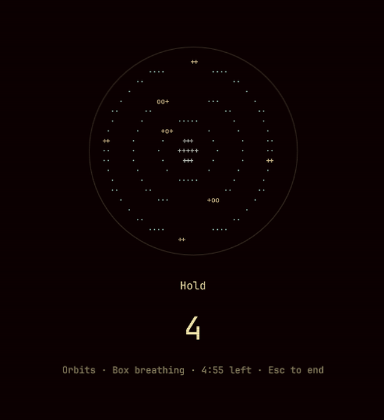
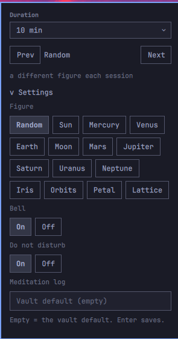

# Terminal Breather

Guided breathing for the Omarchy shell. Follow an animated ASCII planet or geometric figure through box breathing, 4–7–8, coherent, or your own pattern. Start a fullscreen session from the bar, or use the terminal guide when connecting over SSH.

> Fork of [omarchy-zen](https://github.com/ya-luotao/omarchy-zen), maintained as Terminal Breather.

<p align="center">
  
  
</p>

## What it does

- **Guided sessions:** an expanding and contracting ASCII figure, phase label, and countdown.
- **Three built-in patterns:** box, 4–7–8, and coherent breathing.
- **Custom patterns:** define phase lengths, labels, target figure sizes, and optional gradual tempo ramps.
- **Fourteen figures:** the sun, moon, and eight planets, plus four geometric designs; random selection is also available.
- **Bar controls:** choose a pattern, duration, and figure, or middle-click to start the saved defaults.
- **Terminal mode:** the `tb` command provides a breathing guide in an SSH terminal; `--gui` and `--term` choose the mode explicitly.
- **Session history:** records practice minutes and daily streaks; optional Obsidian logging records completed or early-ended sessions of at least one minute.
- **Optional comforts:** a start/end bell and Do Not Disturb, with the previous DND state restored after the session. If the plugin is disabled, removed, or crashes mid-session, the next load turns DND back off.
- **Optional Pomodoro pairing:** OmaPomodorchy can open a selected breathing pattern when a break begins.

## Patterns

| Key | Rhythm | Use |
|---|---|---|
| `box` | In 4 · hold 4 · out 4 · hold 4 | Steady focus |
| `478` | In 4 · hold 7 · out 8 | Winding down |
| `coherent` | In 5.5 · out 5.5 | Slow, even breathing |

## Requirements

- Omarchy Quattro or later
- Obsidian (optional) — only if you want session rows in a meditation log; practice minutes and streaks are tracked in the plugin's own state either way
- Python 3 — records practice minutes from the bar (through `tb-guide --record-stats`) and runs the optional `tb-guide` terminal guide

## Install

```bash
omarchy plugin add https://github.com/AventurineDream/Terminal-Breather.git --enable
```

Remove the plugin with:

```bash
omarchy plugin remove aven.terminal-breather
```

## Start a session

Click the bar icon to choose a pattern, duration, and figure. Middle-click starts the saved defaults. Press `Esc` to end early; time practiced is still recorded. The fullscreen overlay appears on each connected display.

From a terminal:

```bash
omarchy-shell aven.terminal-breather start 478 5  # 4–7–8 breathing for five minutes
omarchy-shell aven.terminal-breather status       # current streak and today's practice
```
Keybindings and other `omarchy-shell shell summon aven.terminal-breather` calls use the saved panel settings for omitted fields; values explicitly included in the summon payload take precedence.

For an SSH-friendly terminal guide, install `tb` and `tb-guide` from a checkout:

```bash
install -Dm755 cli/tb ~/.local/bin/tb
install -Dm755 cli/tb-guide ~/.local/bin/tb-guide
```

```bash
tb                 # saved pattern and duration
tb 478             # choose 4–7–8, saved duration
tb coherent 5      # choose a pattern and duration
tb --term 478 5    # force the terminal guide
tb --gui 478 5     # force the Omarchy overlay
```

`tb --help` lists the supported options. Unknown flags and extra arguments are rejected rather than starting a session.

## Custom patterns

Copy [`patterns.example.json`](patterns.example.json) to `~/.config/omarchy/zen/patterns.json`. Each entry needs a unique lowercase `key`, a `name`, and at least two phases. A phase specifies its `label`, positive finite duration in seconds (`0 < secs ≤ 3600`), and figure target (`to`, from `0` fully exhaled to `1` fully inhaled). Invalid entries are skipped; built-in keys cannot be overridden. Custom patterns are available in the panel, terminal guide, and shell command.

An optional `ramp` changes the phase tempo over the start of a session. `from` and `to` are tempo multipliers from `0.01` to `100`; `overSecs` is from `0` to `3600` seconds, exclusive of `0`. An invalid ramp is dropped while the pattern remains available.

```json
{
  "patterns": [
    {
      "key": "slow-start",
      "name": "Slow start",
      "phases": [
        { "label": "Breathe in", "secs": 4, "to": 1 },
        { "label": "Breathe out", "secs": 4, "to": 0 }
      ],
      "ramp": { "from": 2, "to": 1, "overSecs": 60 }
    }
  ]
}
```

## Settings and history

The panel's **Settings** section controls the figure, bell, Do Not Disturb, the meditation-log on/off switch, and its file path. These values are saved for the next session. The same options can be set through Omarchy:

```bash
omarchy bar set aven.terminal-breather bell false
omarchy bar set aven.terminal-breather dnd false
omarchy bar set aven.terminal-breather animation jupiter
omarchy bar set aven.terminal-breather meditationLogPath "$HOME/notes/meditation.md"
omarchy bar set aven.terminal-breather meditationLogEnabled false
```

Practice minutes and streaks are stored in `stats.json` under Omarchy's local plugin state (`~/.local/state/omarchy/zen/`). That is the same file omarchy-zen uses, so both plugins share one history. Each write re-reads the file under a lock, adds the new minutes, and replaces the file atomically, so concurrent sessions and `tb-guide` do not lose each other's entries. omarchy-zen writes its file without that lock, so its own writes can still overwrite a concurrent update.

The optional meditation log appends a row for sessions of at least one minute, including sessions ended early. Set `meditationLogEnabled` to `false` to turn it off; minutes and streaks are still counted. With `meditationLogPath` empty, the log is `~/Projects/Obsidian/Aventurine/20_Practices/Meditation/Meditation Log.md`; set it to any absolute path to use another note. The log does not create a missing parent folder: if the folder is absent, the row is skipped silently.

## Video

[Watch the Terminal Breather demo](demo-terminal-breather.mp4) — a short, cropped capture of the session overlay and its breathing animation.

## Changelog

### Unreleased

- Plugin id renamed `luotao.zen` → `aven.terminal-breather` (the upstream already holds `luotao.zen` in the marketplace). Existing installs must remove the plugin and re-add it under the new id; patterns and stats under `~/.config/omarchy/zen/` and `~/.local/state/omarchy/zen/` are unchanged.
- The default meditation-log path follows the vault rename: `~/Projects/Obsidian/Home/…` → `~/Projects/Obsidian/Aventurine/…`.
- Hardened session inputs: phase, ramp, and session durations are bounded, and custom-pattern validation matches the overlay. A Do Not Disturb restore now waits for the engage step, so DND can no longer be left on after a session.
- Practice minutes are merged into the shared `stats.json` under a lock and written atomically: the bar hands its minutes to `tb-guide --record-stats`, so concurrent sessions, the terminal guide, and a crash mid-write no longer lose or truncate history. The file format is unchanged.
- Do Not Disturb is restored after an abrupt disable, removal, or crash. The engage step writes `~/.local/state/omarchy/zen/dnd-engaged.json` before turning DND on; the next load turns DND back off when that file is present.
- New `meditationLogEnabled` setting (default on) turns off the Obsidian meditation log. Minutes and streaks are still counted. The Settings panel has an On/Off switch, and `tb-guide` honours the same key.
- The saved bar settings are read from the `aven.terminal-breather` entry again. The overlay had still looked up the old `luotao.zen` id after the rename, so saved settings were ignored for summons that name only some keys.

### 0.8.2

- Figures move within a breath: faster, measured rotation, planet-specific secondary motion, and details that respond to inhale/exhale beyond the overall scale.
- Petal sways, Lattice shimmers, and Orbits moons travel visibly along their tracks. The figure roster, three-layer palettes, stipple style, and breathing clock are unchanged.

### 0.8.1

- Panel height fix: the panel content is no longer clipped — the Begin button is fully visible.

### 0.8.0

- Pattern and duration pickers are shell dropdowns; the choice is saved as the default for the next session.

### 0.7.1

- User-visible "Zen" renamed to "Terminal Breather" (plugin id and data paths unchanged at the time).

## Development

Run the model, renderer, and terminal-guide tests:

```bash
node test/ZenModel.test.js
node test/PlanetArt.test.js
python3 test/tb.test.py
python3 test/tb-guide.test.py
```

## Credits and license

Terminal Breather is a fork of [omarchy-zen](https://github.com/ya-luotao/omarchy-zen). See [LICENSE](LICENSE) for license terms and attribution.
