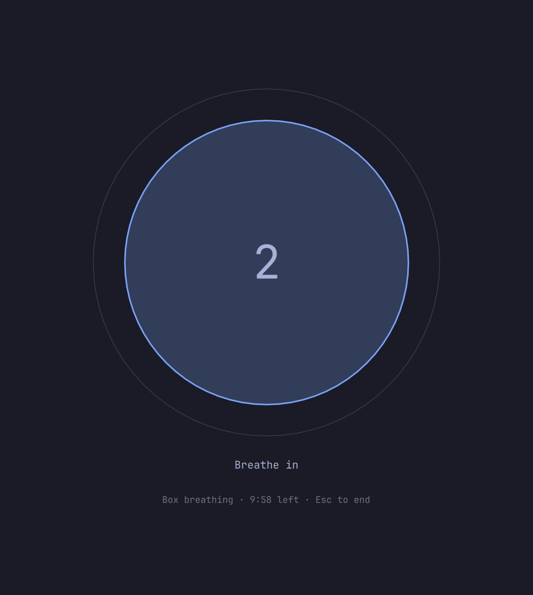
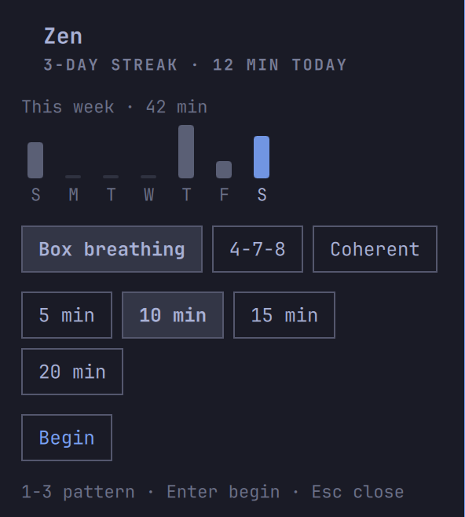

# Terminal-Breather

Guided-breathing meditation as a native [Omarchy](https://omarchy.org) shell plugin (Omarchy 4 "Quattro" or later). A fullscreen visual pacer — an ASCII planet or mandala that grows as you breathe in and shrinks as you breathe out — so the eyes lead the breath and the mind has one thing to come back to.

Pairs with [OmaPomodorchy](https://github.com/AventurineDream/OmoPomodorachy) — the pomodoro timer opens the Breather automatically when a break starts. Install both with one command each (see Install below).

> Fork of [ya-luotao/omarchy-zen](https://github.com/ya-luotao/omarchy-zen), maintained here as Terminal-Breather.

<p align="center">
  
  
</p>

- **Breathing pacer** (fullscreen overlay) — pick a pattern, pick a length, breathe. The figure scales with the breath; phase name and a countdown ride along. The desktop is fully hidden for the duration.
- **Figure** — Sun through Neptune, plus four geometric mandalas (an aperture, orbital tracks, an eight-petal form, a twelve-spoke lattice). `random` picks one per session. Prev/Next in the panel, or `a`, cycles the choice. No five- or six-pointed stars.
- **Bar widget** — an ensō in the bar: click to choose pattern, length, and figure; middle-click starts the usual session immediately. The tooltip carries the daily streak, the panel a seven-day practice view.
- **Session tracking** — minutes per day in `~/.local/state/omarchy/zen/stats.json`. Ending early still logs the minutes you actually practiced: a streak kept by a short session beats one lost to perfectionism.
- **Session comforts** — a soft bell at start and end, and do-not-disturb engaged for the duration (borrowed, not owned: your previous DND state is restored afterwards). Both on by default, both optional.

## Patterns

| Key | Pattern | Rhythm | Good for |
|---|---|---|---|
| `box` | Box breathing | in 4 · hold 4 · out 4 · hold 4 | steady focus |
| `478` | 4-7-8 | in 4 · hold 7 · out 8 | winding down |
| `coherent` | Coherent | in 5.5 · out 5.5 | balance, ~5.5 breaths/min |

## Custom patterns

Add your own breathing patterns in `~/.config/omarchy/zen/patterns.json` — copy `patterns.example.json` there and edit it. Each pattern needs a unique `key` (lowercase letters, digits, dashes), a `name`, and at least two `phases`; each phase has a `label`, seconds (`secs`, above 0), and where the circle ends up (`to`: 1 fully inhaled, 0 fully exhaled). A key that collides with a built-in (`box`, `478`, `coherent`) is ignored, and any invalid entry is skipped — a typo in the file never breaks the built-in patterns. The panel lists custom patterns after the built-ins (`1`–`9` picks one), and they work everywhere the built-ins do: panel, keybinding payload, and `omarchy-shell luotao.zen start <key> <minutes>`. The file is re-read whenever the panel opens, so edits apply without restarting the shell.

A pattern may also carry a `ramp` — `"ramp": {"from": 2, "to": 0.5, "overSecs": 60}` scales every phase from twice as slow to twice as fast over the first minute of the session, so it starts slow and builds speed. Breath of Fire in the example file uses this: short in/out phases, ramping from 30 breaths a minute to 120 over the first minute. An invalid ramp is dropped and the pattern kept.

## Meditation log

Every session that reaches at least one minute gets one row in an Obsidian meditation log, appended when the session ends — completed or ended early, the minutes actually practiced are what lands:

```markdown
| Date | Pattern | Minutes | Completed |
| 2026-11-11 | Breath of Fire | 5 | yes |
```

By default the log is `~/Projects/Obsidian/Home/20_Practices/Meditation/Meditation Log.md`. Change it in the plugin settings (`meditationLogPath`); leave it empty for the default. If the file is missing it is created with the table header first. If the folder is missing the row is skipped silently — the stats still log, and nothing is written somewhere the vault is not. Sessions under a minute are not logged, same as the stats.

## Install

```bash
omarchy plugin add https://github.com/AventurineDream/Terminal-Breather.git --enable
```

Pairs with OmaPomodorchy (optional — the timer opens the Breather when a break starts):

```bash
omarchy plugin add https://github.com/AventurineDream/OmoPomodorachy.git --enable
```

## Demo

[Watch the demo video](demo-terminal-breather.mp4) — a short look at the breathing overlay: the circle grows as you breathe in and shrinks as you breathe out, with the phase name and countdown riding along.

## Keybinding

Add to `~/.config/hypr/bindings.lua`:

```lua
o.bind("SUPER + SHIFT + B", "Breathe",
  [[omarchy-shell shell summon luotao.zen '{"pattern": "box", "minutes": 10}']])
```

Omit the payload keys to use the defaults (`{}` works too).

## Usage

- Left-click the ensō → panel: pattern, length, **Begin** (`1`–`9` picks a pattern, `Enter` begins)
- Middle-click the ensō → start immediately with your saved defaults
- During a session: `Esc` ends early (practice up to that point still counts)
- Session complete → a notification with your updated streak
- The session shows on every display at once, circles in sync — Esc works from whichever screen you are looking at (keyboard focus sits on the first screen's panel)

From scripts:

```bash
omarchy-shell luotao.zen start 478 5   # pattern, minutes
omarchy-shell luotao.zen status        # {"streakDays":3,"todayMinutes":15,...}
```

Pattern and length chosen in the panel are written back to `shell.json`, so your last choice is the default next time.

### Terminal shortcut (`tb`)

A one-word launcher for the terminal — handy over SSH, where the
fullscreen overlay opens on the machine's own displays and you cannot
see it from the phone. Install it once:

```bash
cp cli/tb cli/tb-guide ~/.local/bin/
chmod +x ~/.local/bin/tb ~/.local/bin/tb-guide
```

Then type `tb` and press Enter. It uses your saved defaults (pattern
and minutes from `shell.json`); override them the same way as the
other commands:

```bash
tb          # saved defaults
tb 478      # 4-7-8 breathing, saved minutes
tb 478 10   # 4-7-8 breathing, 10 minutes
```

Where the session shows up depends on how you are connected. On the
machine itself it summons the fullscreen overlay. Over SSH (Termius
or any SSH app on a phone) it runs a breathing guide right in the
terminal instead — a circle that grows as you breathe in, holds, and
shrinks as you breathe out, coloured by phase, with the phase name and
countdown riding along — the same patterns and timings as the overlay,
including your custom patterns from `patterns.json`. `Ctrl+C` ends it
early; sessions under a minute are not logged, same as the overlay.
`tb --gui` forces the overlay and `tb --term` forces the terminal
guide, whichever way you are connected. `tb --help` prints the usage;
unknown `--options` and extra arguments are rejected instead of
starting a session, so a typo can never silently log a session.

### Settings

The panel has a collapsible **Settings** section (below the figure picker): a picker for the 14 figures plus Random, bell and do-not-disturb toggles, and a field for the meditation-log path (empty = the vault default). Every change is written back to `shell.json`, so it is the default from then on. The same settings are also available from the command line:

```bash
omarchy bar set luotao.zen bell false   # no bells
omarchy bar set luotao.zen dnd false    # leave notifications alone
omarchy bar set luotao.zen meditationLogPath "/home/aven/notes/meditation.md"  # log somewhere else (empty = vault default)
omarchy bar set luotao.zen animation jupiter   # sun … neptune, iris, orbits, petal, lattice, or random
```

Per-summon overrides work too: `'{"pattern": "box", "minutes": 10, "animation": "saturn", "bell": false, "dnd": false}'`.

## Uninstall

```bash
omarchy plugin remove luotao.zen
```

Remove any keybindings you added to `~/.config/hypr/bindings.lua`. Your practice history in `~/.local/state/omarchy/zen/` is left in place; delete it by hand if you want it gone.

## Roadmap

- Soundscapes (rain, brown noise) during sessions
- Interval chimes ("mindful bell every 5 minutes")

## Development

The pure model (`ZenModel.js`) and the figure renderer (`PlanetArt.js`) are covered by node harnesses — no shell needed:

```bash
node test/ZenModel.test.js
node test/PlanetArt.test.js
python3 test/tb-guide.test.py
```

The QML layer (FileView timing, panel wiring) is reviewed by diff and verified on a live Omarchy shell.

## License

MIT
